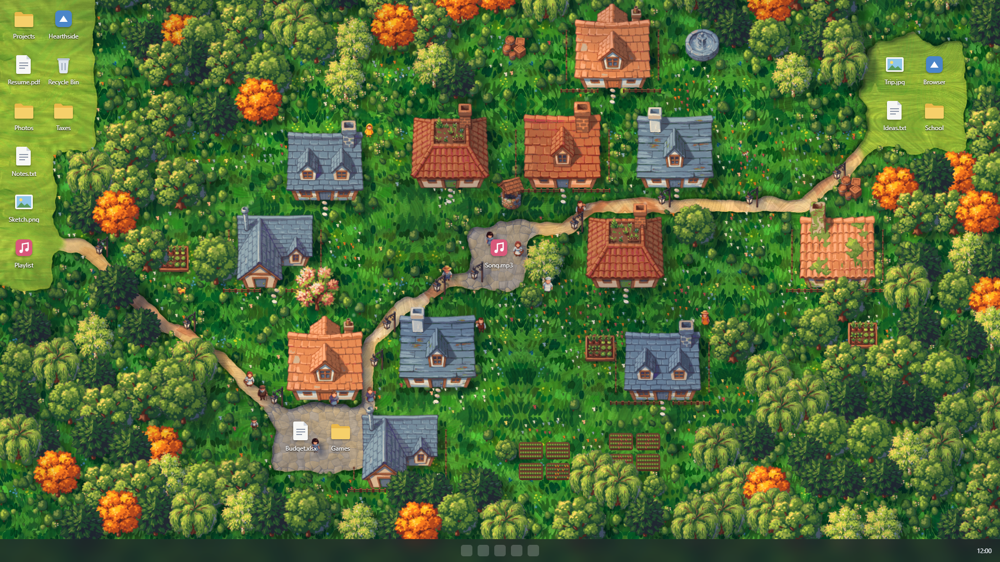
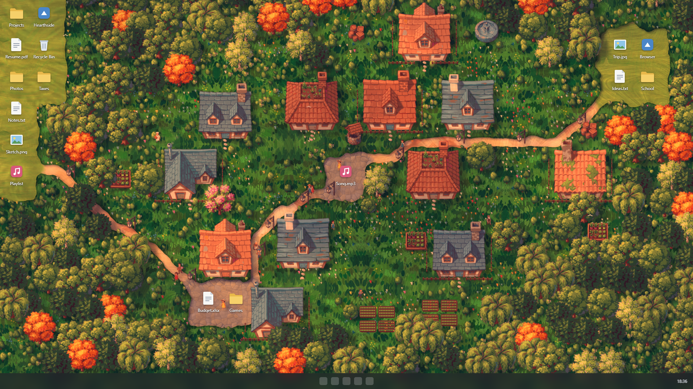
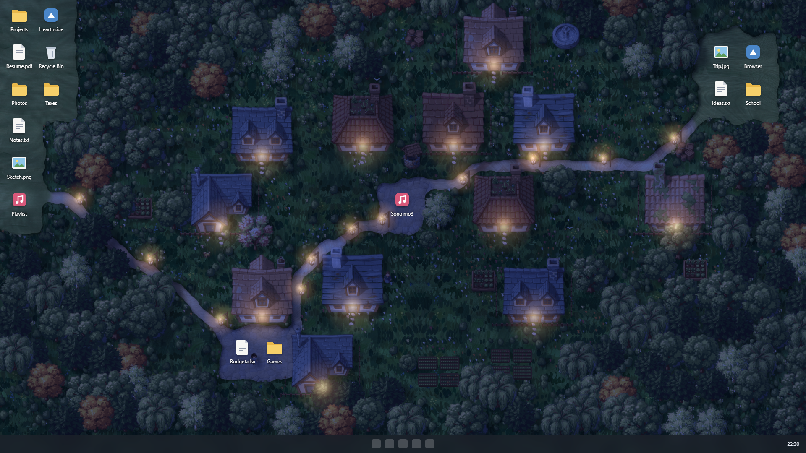
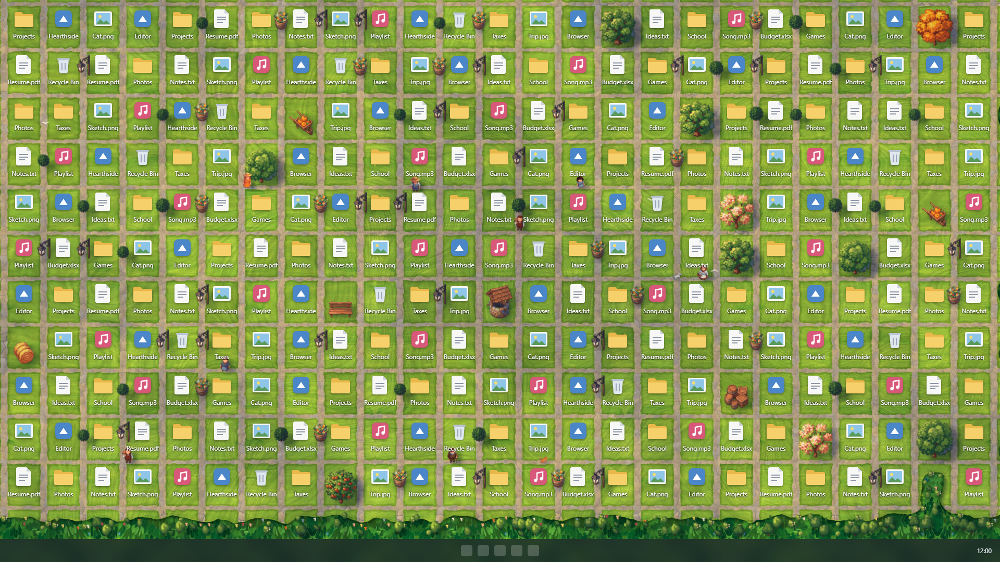

# Hearthside

A live Windows wallpaper: a small hand-painted village seen from high above, living behind your desktop
icons. The village rearranges itself around wherever your icons are. Icons get open plazas under them,
houses and trees step aside, paths link groups of icons, and villagers, a cat and a dog stroll the lanes.
Drag an icon somewhere new and the ground ripples out from where you dropped it.

**[Try the browser demo](https://braydon2622.github.io/hearthside/)**: drag the stand-in icons around, use
"Fill desktop", and move the time slider through sunset and night.



| Sunset | Night |
| --- | --- |
|  |  |

A crowded desktop turns into a "district" of lawn lots and cobbled lanes, with houses, trees and props in
the empty slots:



## How it works

- **The land is a field, not a picture.** Every icon rectangle (icon plus label) adds a soft Gaussian hill
  of open ground; paths and empty slots add theirs. The noise-bent sum becomes a signed distance field,
  computed only when icons move and handed to the GPU as two small float textures (old and new). The
  shader morphs between them, rippling out from the drop point. Plaza edges, the dark grass lip and the
  shadow inside the plaza are all contours of that one field.
- **One WebGL2 renderer.** The ground is painted off-screen and only repainted while it morphs; everything
  standing is one instanced draw from a sprite atlas; a finishing pass adds drifting cloud shadows, bloom,
  a time-of-day colour grade and paper grain.
- **One light.** No sprite carries its own shadow. The engine casts every object's blurred silhouette away
  from the top-left light into one shadow buffer, so everything sits in the same scene.
- **One palette.** All painted sprites are snapped to a shared 28-colour palette with a painted edge, so
  art from different sheets reads as one set.
- **Density from code.** Over a thousand bushes, flower drifts, crop fields, fences and stepping stones
  are drawn from a few code-painted templates, placed from the field and kept quiet near icons so labels
  stay readable.
- **The Windows side** (Tauri v2 + Rust) puts the window between the wallpaper and the desktop icons,
  reads icon positions through `IFolderView`, and pauses the page whenever a maximised window covers the
  desktop. It uses about 5 to 9 % of one CPU core while animating and well under 1 % while covered.

## Running it

Browser prototype (no install needed beyond PowerShell):

```
powershell -ExecutionPolicy Bypass -File tools/serve.ps1
```

then open http://localhost:5173. URL options: `?hour=18.6` fixes the time, `?fill=1` crowds the desktop,
`?clean=1` hides the panel.

The real wallpaper needs Rust and the Tauri v2 prerequisites:

```
cd src-tauri
cargo build
target\debug\hearthside.exe
```

Quit it from its tray icon. Windows 10 and Windows 11 (including 24H2) are supported.

## About the art

The painted sprites and ground textures are **AI-generated** (Figma `generate_image`, model
gemini-3.1-flash-image) from prompts written for this project, then cut, palette-matched and edge-painted
by `tools/cut-sprites.ps1`. Every generated file, with its model, date and prompt, is listed in
[art/SOURCES.md](art/SOURCES.md). Everything else (the ground, shadows, filler, lighting and animation) is
drawn by code.

## Project notes

[progress.md](progress.md) is the build log for the second version: six milestones, what was measured at
each step, and before/after screenshots in [docs/milestones](docs/milestones).

## License

Code: MIT, see [LICENSE](LICENSE).
